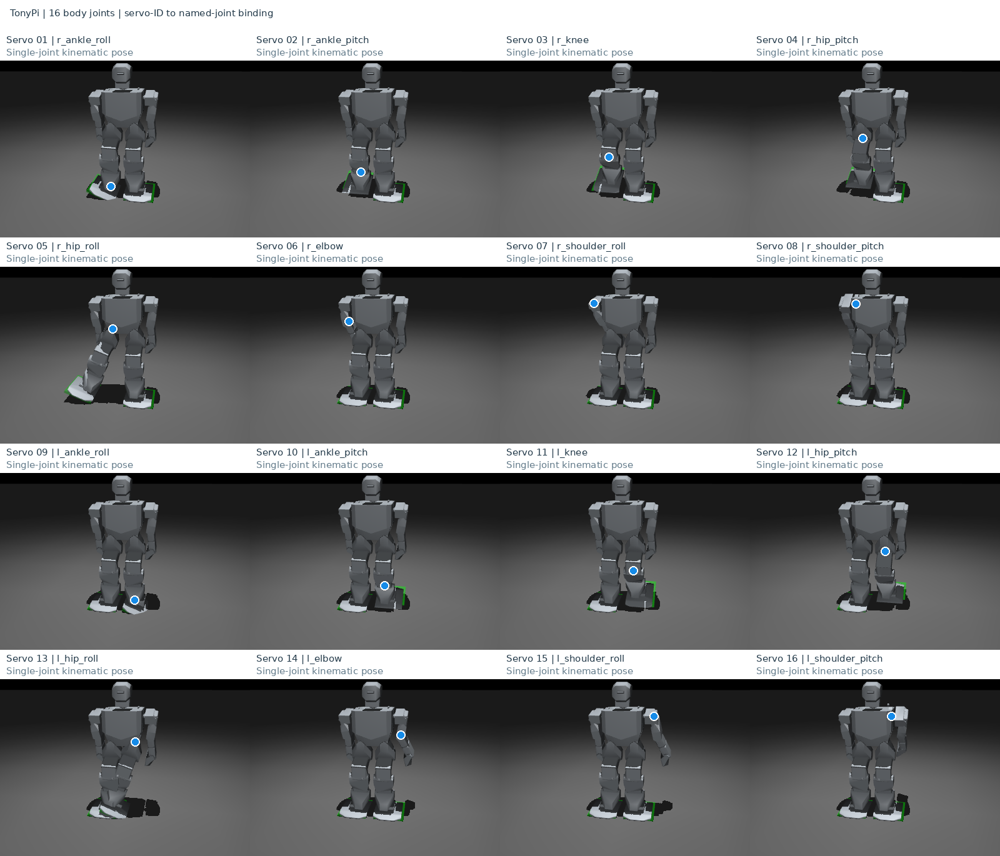
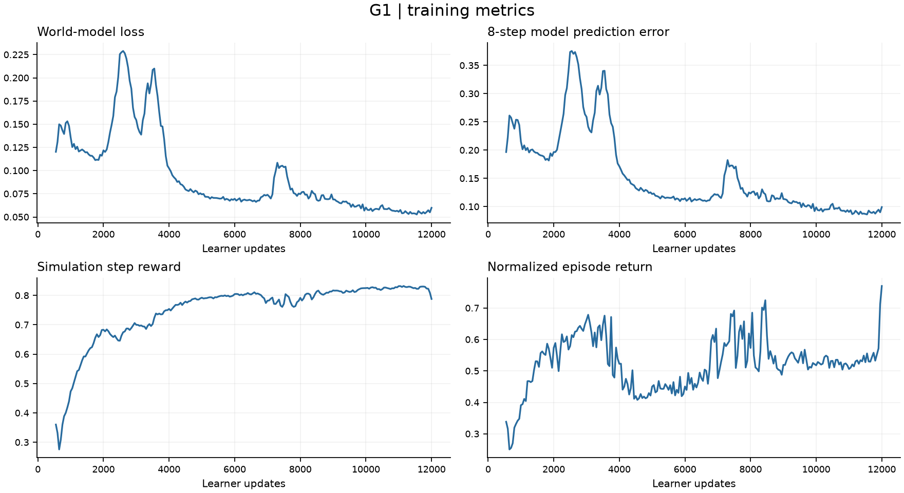
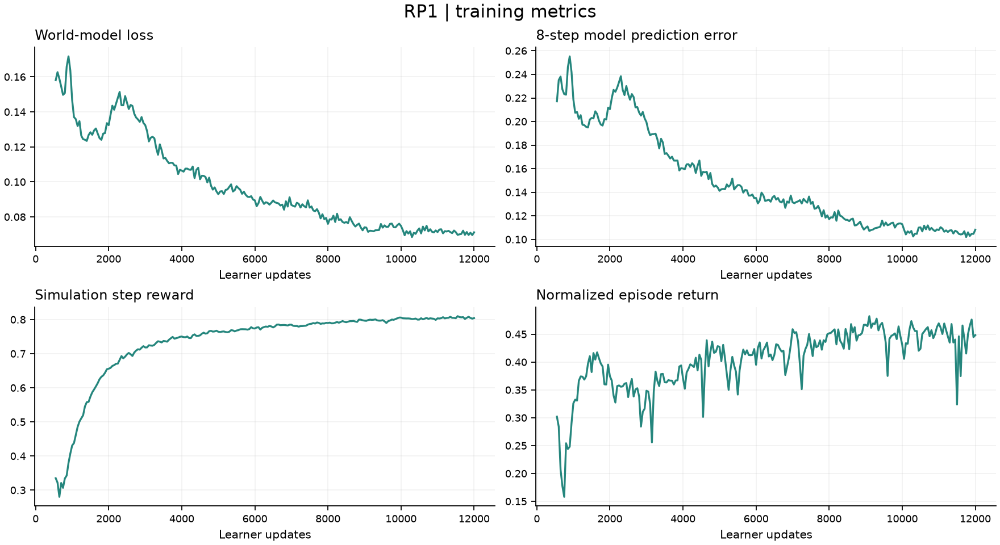
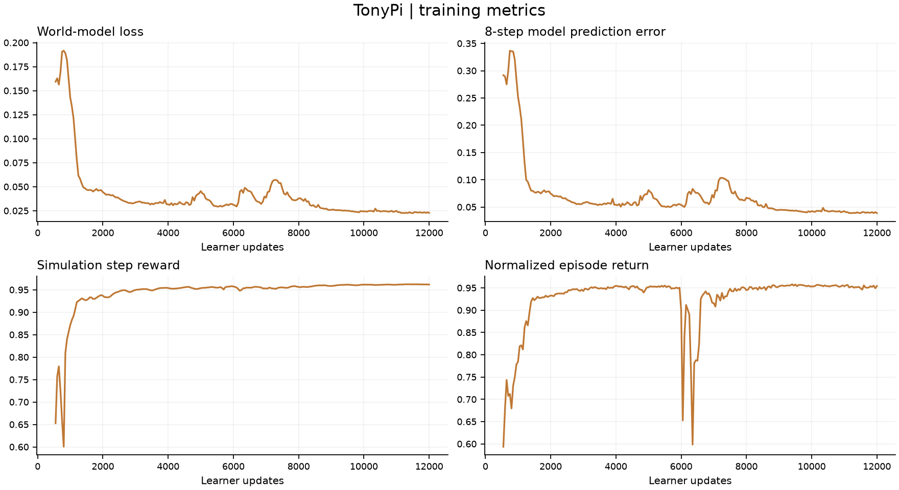

<h1 align="center">SuperMimic Robotics Exploration</h1>
<p align="center"><strong>Motion tracking with G1, RP1 and TonyPi</strong></p>
<p align="center">English | <a href="README_zh-CN.md">简体中文</a> · <a href="https://supermimic.github.io/">SuperMimic</a> · <a href="https://arxiv.org/abs/2610.28480">Paper</a> · <a href="https://github.com/Motphys/Uni-SuperMimic">Upstream</a></p>

## Overview

**SuperMimic** learns robot motion tracking through a differentiable world model: the model learns simulated dynamics, and the policy optimizes actions using predicted rewards. **[Uni-SuperMimic](https://github.com/Motphys/Uni-SuperMimic)** independently reproduces this method on UniLab.

This project builds on Uni-SuperMimic to explore robot integration, motion preparation, training and evaluation for **G1, RP1 and TonyPi**, with future Sim-to-Real experiments on a physical TonyPi. Each robot has its own world model, policy and critic.

## Motion showcase

Twelve-motion grids from the final policies (12,000 updates). Each preview is 30 seconds.

### G1

29 controlled joints; 40 motions from the [LAFAN1 Retargeting Dataset](https://huggingface.co/datasets/lvhaidong/LAFAN1_Retargeting_Dataset).

https://github.com/user-attachments/assets/109bbeb8-ed9c-4491-983a-3df4fb7368fd

### RP1

28 controlled joints; 40 corresponding RP1 motions from [any4hdmi-rp1-lafan](https://huggingface.co/datasets/elijahgalahad/any4hdmi-rp1-lafan).

https://github.com/user-attachments/assets/b47e135b-a7ff-4f48-82e7-006238484897

### TonyPi

16 body joints, with the head and grippers fixed. References are captured from `.d6a` action groups in simulation, including individual actions, standing transitions, gait cycles and mixed sequences: 372 training trajectories and 27 composition-validation trajectories.

https://github.com/user-attachments/assets/115c12ee-9c7d-4c07-b82f-e3151dc178d8

<details>
<summary>TonyPi joint mapping</summary>

Servo IDs 1–8 map to the right side and 9–16 to the left. Policy and motion coordinates are mapped by joint name.



</details>

Simulation training and evaluation are complete. Deployment of the learned policy on physical hardware is in preparation.

## Policy learning progress

### G1 / RP1: early and final policies

A 30-second four-panel comparison. G1 is on top and RP1 below; the left column uses **2,000** updates and the right uses **12,000**.

https://github.com/user-attachments/assets/b966a476-acca-4972-989a-7dfe72ccfcd0

### G1 / RP1: three training stages

The full `fightAndSports1_subject1` motion, approximately 245 seconds. G1 is on top and RP1 below; columns show **2,000 / 6,000 / 12,000** updates from left to right.

https://github.com/user-attachments/assets/48540b90-8fec-4346-96e3-512d2c78c162

### TonyPi: three training stages

The same complete 41.44-second reference motion at **2,000 / 6,000 / 12,000** updates, from left to right.

https://github.com/user-attachments/assets/977ab5fa-9fda-4a81-890b-80a4cd0b31f0

Solid robots show the policy; blue robots show the reference, aligned to the policy in XY for pose comparison. Global position errors are computed from unaligned trajectories.

## Results

Each robot trains on one **A100-PCIE-40GB**, with 4,096 parallel environments, BF16 and the mjwarp backend, for 12,000 updates.

| Robot | Motion data | Completed | Mean normalized return | Training time |
|---|---|---:|---:|---:|
| G1 · 29 DoF | 40 LAFAN1 clips | 40 / 40 | 0.8694 | 5.03 h |
| RP1 · 28 DoF | 40 RP1 LAFAN clips | 40 / 40 | 0.8436 | 4.73 h |
| TonyPi · 16 DoF | 372 training trajectories | 370 / 372 | 0.9897 | 4.43 h |
| TonyPi composition validation | 27 new orders of seen primitives | 27 / 27 | 0.9936 | Same policy |

Completion means no task termination was triggered. Two TonyPi backward-fall clips remain incomplete, and some long gaits exhibit positional drift. Returns are not a ranking across robots because datasets and reward tolerances differ. Composition validation does not establish generalization to unseen skills.

### Training curves

World-model loss, eight-step prediction error, simulator step reward and normalized episode return, shown after the first 500 world-model warmup updates.

**G1**



**RP1**



**TonyPi**



## Quick start

Linux, Python 3.11 and a CUDA-capable NVIDIA GPU. Robot models and reference motions are under `src/unisupermimic/assets/`.

```bash
uv sync --locked

# Choose a robot and use a separate output directory for each run.
uv run python scripts/train.py g1 --run-dir runs/g1_new
uv run python scripts/train.py rp1 --run-dir runs/rp1_new
uv run python scripts/train.py tonypi --run-dir runs/tonypi_new

# Evaluate a checkpoint produced by training.
uv run python scripts/evaluate.py tonypi --ckpt runs/tonypi_new/ckpt_012000.pt
```

| Directory | Contents |
|---|---|
| `src/` | Algorithms, tasks, robot models and motion data |
| `configs/` | Training profiles for the three robots |
| `scripts/` | Training, evaluation and checkpoint export entry points |
| `tools/` | Data preparation and rendering utilities |
| `assets/` | README videos and images |
| `results/` | Run configurations, training logs, metrics and checkpoint index |

## Acknowledgements and license

Method: [SuperMimic](https://supermimic.github.io/). Implementation: [Uni-SuperMimic](https://github.com/Motphys/Uni-SuperMimic) and UniLab. Robot resources: [Roboparty/RP1](https://github.com/Roboparty/RP1) and [pab47/TonyPi](https://github.com/pab47/TonyPi). Original TonyPi action groups are from Hiwonder.

See [LICENSE](LICENSE), [NOTICE](NOTICE) and [LICENSES](LICENSES/) for code licensing and third-party notices. External models and datasets retain their respective licenses.
