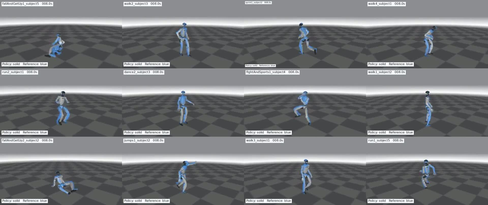
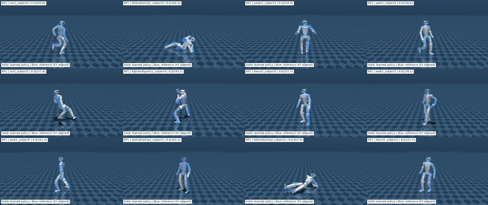
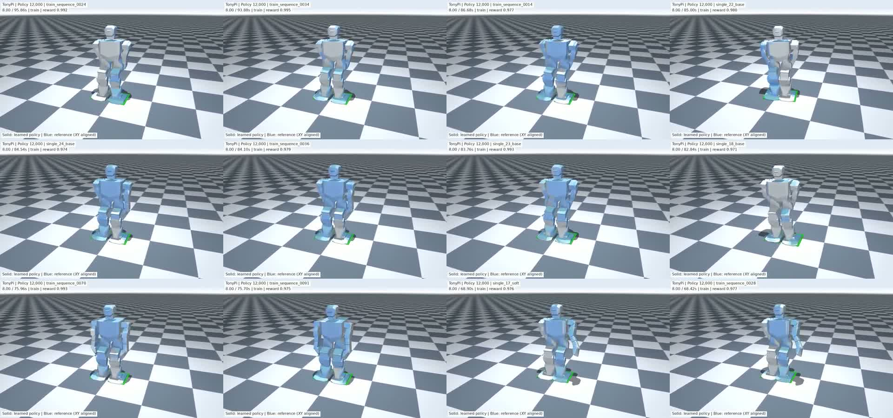
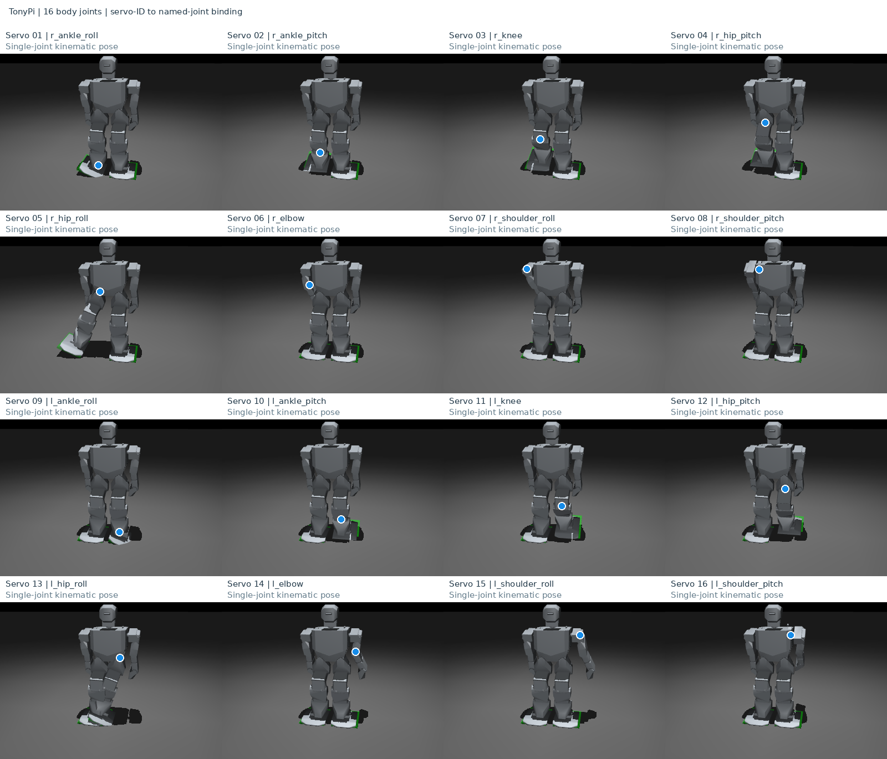
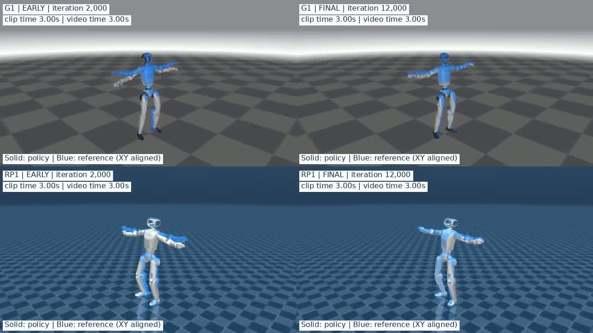
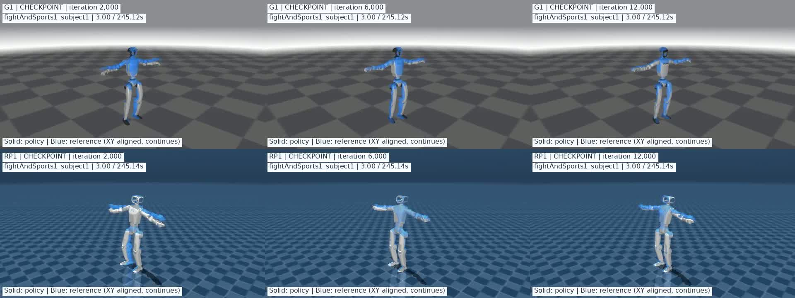
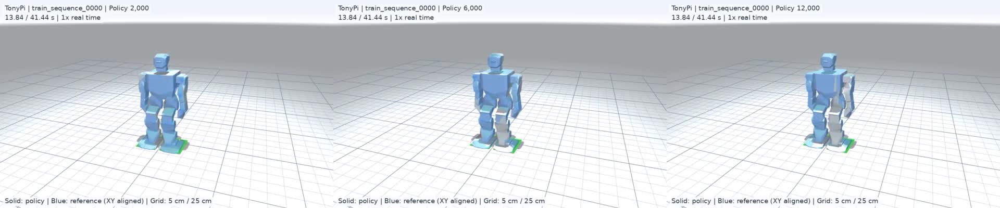
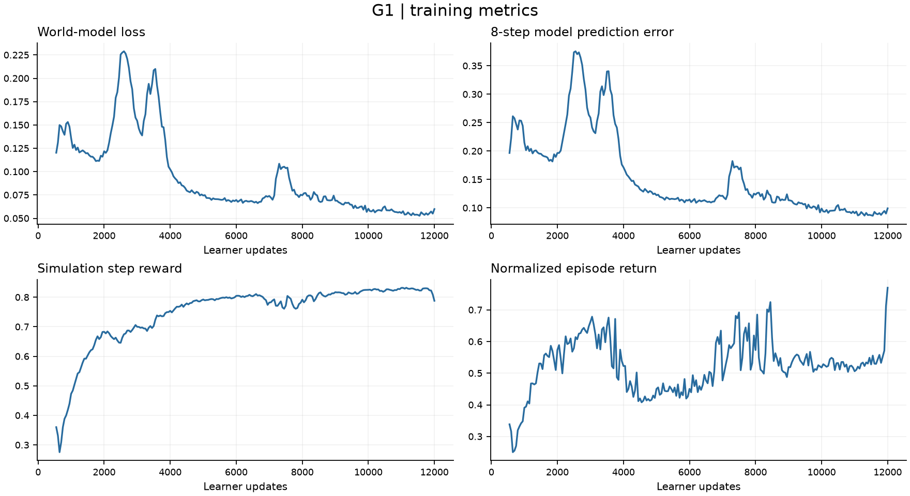
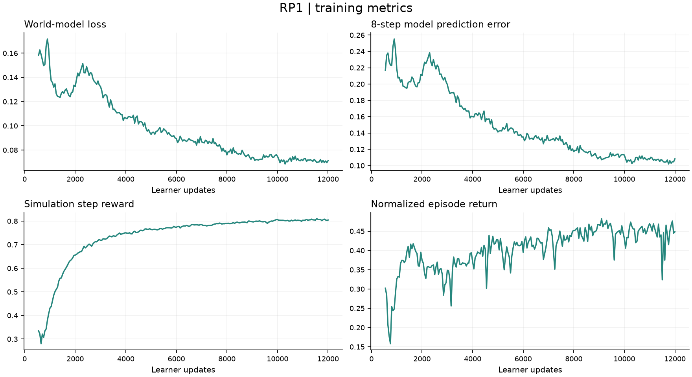
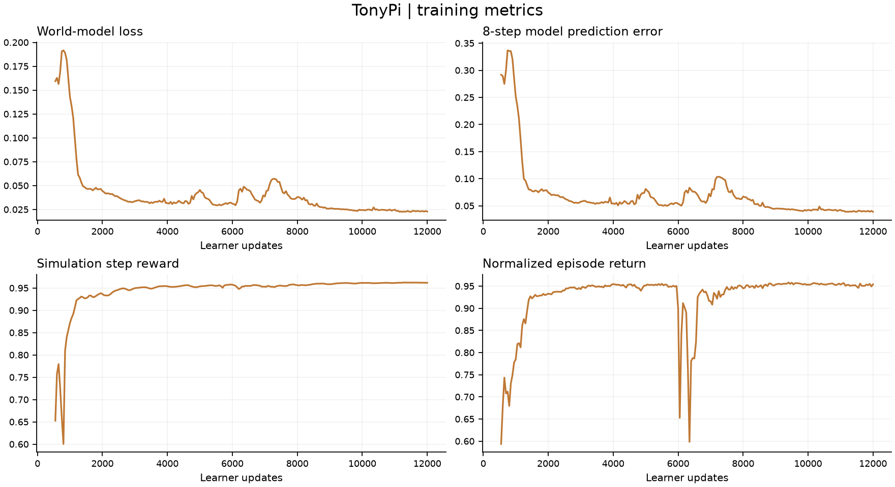

<h1 align="center">SuperMimic Robotics Exploration</h1>
<p align="center"><strong>G1、RP1 与 TonyPi 的动作跟踪</strong></p>
<p align="center"><a href="README.md">English</a> | 简体中文 · <a href="https://supermimic.github.io/">SuperMimic</a> · <a href="https://arxiv.org/abs/2610.28480">论文</a> · <a href="https://github.com/Motphys/Uni-SuperMimic">上游项目</a></p>

## 简介

**SuperMimic** 通过可微世界模型学习机器人动作跟踪：世界模型学习仿真动力学，策略利用模型预测的奖励优化动作。**[Uni-SuperMimic](https://github.com/Motphys/Uni-SuperMimic)** 是该方法在 UniLab 上的独立复现。

本项目基于 Uni-SuperMimic，探索 **G1、RP1 和 TonyPi** 的机器人适配、动作数据准备、训练与评估，并为 TonyPi 实机上的 Sim-to-Real 实验做准备。每个机器人独立训练世界模型、Policy 和 Critic。

## 动作展示

最终 Policy（12,000 次更新）的十二宫格动作预览，每段视频 30 秒。

### G1

29 个受控关节；使用 [LAFAN1 Retargeting Dataset](https://huggingface.co/datasets/lvhaidong/LAFAN1_Retargeting_Dataset) 的 40 段动作。

<video controls preload="none" width="100%" poster="assets/images/G1_12grid_preview_30s.jpg" src="assets/videos/G1_12grid_preview_30s.mp4">
  <a href="assets/videos/G1_12grid_preview_30s.mp4"></a>
</video>

[▶ G1 · 十二宫格动作展示](assets/videos/G1_12grid_preview_30s.mp4)

### RP1

28 个受控关节；使用 [any4hdmi-rp1-lafan](https://huggingface.co/datasets/elijahgalahad/any4hdmi-rp1-lafan) 中对应的 40 段 RP1 重定向动作。

<video controls preload="none" width="100%" poster="assets/images/RP1_12grid_preview_30s.jpg" src="assets/videos/RP1_12grid_preview_30s.mp4">
  <a href="assets/videos/RP1_12grid_preview_30s.mp4"></a>
</video>

[▶ RP1 · 十二宫格动作展示](assets/videos/RP1_12grid_preview_30s.mp4)

### TonyPi

16 个身体关节，头部与夹爪固定。参考动作由 `.d6a` 动作组在仿真中采集，包含单动作、站姿过渡、步态循环与混合序列；训练集 372 条轨迹，组合验证集 27 条轨迹。

<video controls preload="none" width="100%" poster="assets/images/TonyPi_12grid_preview_30s.jpg" src="assets/videos/TonyPi_12grid_preview_30s.mp4">
  <a href="assets/videos/TonyPi_12grid_preview_30s.mp4"></a>
</video>

[▶ TonyPi · 十二宫格动作展示](assets/videos/TonyPi_12grid_preview_30s.mp4)

<details>
<summary>TonyPi 关节映射</summary>

舵机编号 1–8 对应右侧，9–16 对应左侧；策略和动作文件按关节名称映射。



</details>

TonyPi 已完成仿真训练与评估，学习策略的真机部署处于准备阶段。

## Policy 训练过程

### G1 / RP1：早期与最终 Policy

30 秒四宫格对比。上排 G1、下排 RP1；左列为 **2,000** 次更新，右列为 **12,000** 次更新。

<video controls preload="none" width="100%" poster="assets/images/comparison_4panel.jpg" src="assets/videos/comparison_4panel.mp4">
  <a href="assets/videos/comparison_4panel.mp4"></a>
</video>

[▶ G1 / RP1 · 早期与最终 Policy](assets/videos/comparison_4panel.mp4)

### G1 / RP1：三个训练阶段

完整的 `fightAndSports1_subject1` 动作，约 245 秒。上排 G1、下排 RP1；从左至右为 **2,000 / 6,000 / 12,000** 次更新。

<video controls preload="none" width="100%" poster="assets/images/comparison_6panel.jpg" src="assets/videos/comparison_6panel.mp4">
  <a href="assets/videos/comparison_6panel.mp4"></a>
</video>

[▶ G1 / RP1 · 三阶段完整动作对比](assets/videos/comparison_6panel.mp4)

### TonyPi：三个训练阶段

同一段完整的 41.44 秒参考动作，从左至右为 **2,000 / 6,000 / 12,000** 次更新。

<video controls preload="none" width="100%" poster="assets/images/tonypi_progress.jpg" src="assets/videos/tonypi_progress.mp4">
  <a href="assets/videos/tonypi_progress.mp4"></a>
</video>

[▶ TonyPi · 三阶段完整动作对比](assets/videos/tonypi_progress.mp4)

视频中实体为 Policy，蓝色为参考动作。蓝色参考的 XY 位置与 Policy 对齐，用于比较姿态；全局位置误差使用未对齐轨迹计算。

## 实验结果

每个机器人使用单张 **A100-PCIE-40GB**，4,096 个并行环境、BF16、mjwarp 后端，训练 12,000 次更新。

| 机器人 | 动作数据 | 完整执行 | 平均归一化回报 | 训练耗时 |
|---|---|---:|---:|---:|
| G1 · 29 DoF | 40 段 LAFAN1 | 40 / 40 | 0.8694 | 5.03 小时 |
| RP1 · 28 DoF | 40 段 RP1 LAFAN | 40 / 40 | 0.8436 | 4.73 小时 |
| TonyPi · 16 DoF | 372 条训练轨迹 | 370 / 372 | 0.9897 | 4.43 小时 |
| TonyPi 组合验证 | 已见基础动作的 27 种新排列 | 27 / 27 | 0.9936 | 同一策略 |

完整执行表示未触发任务终止。TonyPi 的两条向后倒地动作未完成，部分长步态存在位置漂移。不同机器人的数据与奖励容差不同，回报不用于跨机器人排名；组合验证不代表未见技能泛化。

### 训练曲线

世界模型损失、8 步预测误差、仿真每步奖励和归一化 episode 回报；展示前 500 次世界模型预训练之后的训练阶段。

**G1**



**RP1**



**TonyPi**



## 快速开始

Linux、Python 3.11、支持 CUDA 的 NVIDIA GPU。机器人模型和参考动作位于 `src/unisupermimic/assets/`。

```bash
uv sync --locked

# 选择一个机器人，每个实验使用独立的输出目录。
uv run python scripts/train.py g1 --run-dir runs/g1_new
uv run python scripts/train.py rp1 --run-dir runs/rp1_new
uv run python scripts/train.py tonypi --run-dir runs/tonypi_new

# 评估训练生成的 checkpoint。
uv run python scripts/evaluate.py tonypi --ckpt runs/tonypi_new/ckpt_012000.pt
```

| 目录 | 内容 |
|---|---|
| `src/` | 算法、任务实现、机器人模型与动作数据 |
| `configs/` | 三个机器人的训练配置 |
| `scripts/` | 训练、评估与 checkpoint 导出入口 |
| `tools/` | 数据处理和渲染工具 |
| `assets/` | README 视频与图片 |
| `results/` | 实验配置、训练日志、指标与 checkpoint 索引 |

## 致谢与许可

方法来自 [SuperMimic](https://supermimic.github.io/)，实现基于 [Uni-SuperMimic](https://github.com/Motphys/Uni-SuperMimic) 与 UniLab。机器人资源来自 [Roboparty/RP1](https://github.com/Roboparty/RP1)、[pab47/TonyPi](https://github.com/pab47/TonyPi)；TonyPi 原始动作组来自 Hiwonder。

代码许可与第三方声明见 [LICENSE](LICENSE)、[NOTICE](NOTICE) 和 [LICENSES](LICENSES/)。外部模型和数据保留各自许可。
